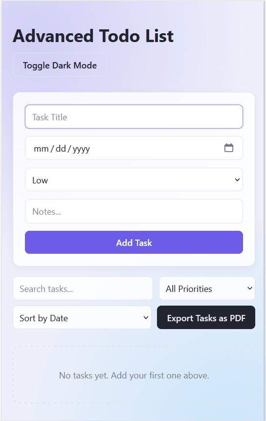
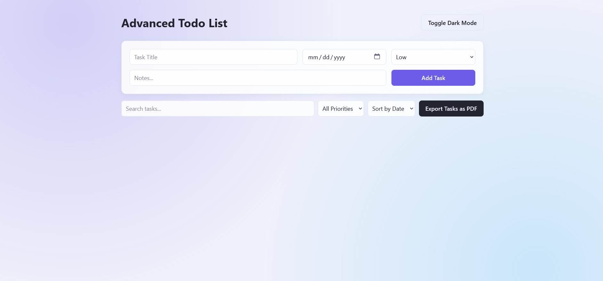

# ✅ Advanced Todo List

A responsive todo app built with vanilla HTML, CSS, and JavaScript. Tasks can be added with a due date, priority, and notes, then searched, filtered, sorted, edited, completed, and exported as a PDF. Everything is saved in the browser, so your tasks are still there after a refresh.

## 📖 Description

Advanced Todo List is a front-end practice project focused on JavaScript logic and DOM manipulation. The UI is built from scratch with a soft pastel card design, a light and dark theme, and a layout that adapts to desktop, tablet, and mobile screens.

Tasks and the theme preference are stored with the Web Storage API (`localStorage`), so they survive page refreshes and browser restarts.

> This project is built purely for practice and portfolio purposes.

## ✨ Features

- Add tasks with a title, due date, priority (low, medium, high), and notes
- Edit tasks: the form is filled with the task's data and the button changes to "Save Changes"
- Delete tasks (the form resets if the task being edited is deleted)
- Mark tasks as complete or reopen them with one button
- Live search by title (case-insensitive)
- Filter tasks by priority
- Sort tasks by due date, ascending or descending
- Search, filter, and sort work together on the same list
- Tasks are saved in `localStorage` and restored after a refresh
- The light or dark theme is remembered between visits
- Export tasks as a PDF file
- Color-coded priority labels on every card
- Empty state message when there are no tasks
- Input validation: empty or whitespace-only titles are ignored
- Safe rendering of task titles with `textContent` to prevent XSS
- Safe storage access with `try/catch` and a check of the saved data
- Responsive design for desktop, tablet, and mobile

## 🛠️ Technologies

- HTML5
- CSS3
- Flexbox
- CSS Grid
- CSS Custom Properties (for the light and dark themes)
- Media Queries
- JavaScript (ES6+)
- Web Storage API (`localStorage`)
- [jsPDF](https://github.com/parallax/jsPDF) (loaded from a CDN, used for the PDF export)

> No frameworks were used. jsPDF is the only external library.

🔗 **Live Demo:** [View live project](https://anahita-valipour.github.io/Todo-list-advance/) <!-- update this link once GitHub Pages is enabled -->

---

## 📸 Preview

|               Mobile View                |               Desktop View                |
| :--------------------------------------: | :---------------------------------------: |
|  |  |

---

## 📁 Project Structure

```text
Todo-list-advance/
├── screenshots/
│   ├── desktop.gif
│   └── mobile.gif
├── index.html
├── styles.css
├── script.js
└── README.md
```

## 🚀 How to Run

Clone the repository and open `index.html` in your browser. No installation required.

```bash
git clone https://github.com/anahita-valipour/Todo-list-advance.git
```

Or open the project in VS Code and run it with the **Live Server** extension.

> An internet connection is needed for the PDF export, because jsPDF is loaded from a CDN.

## 🎯 Learning Goals

This project was built to practice and strengthen:

- Manipulating the DOM with `createElement`, `append`, and `querySelector`
- Handling events with `click`, `input`, and `change` listeners
- Using array methods like `filter`, `sort`, and `forEach`
- Keeping one source of truth (the `tasks` array) and rendering the UI from it
- Saving and loading data with `localStorage`, `JSON.stringify`, and `JSON.parse`
- Handling errors and invalid saved data with `try/catch`
- Working with dates and sorting objects
- Using a third-party library in a vanilla JavaScript project
- Building a responsive layout with Flexbox and CSS Grid
- Creating a light and dark theme with CSS variables

## 🔮 Future Improvements

- Show each task's notes on its card
- Drag and drop to reorder tasks
- Persian font support in the PDF export

---

## 👩‍💻 Author

**Anahita Valipour**
🔗 [GitHub](https://github.com/anahita-valipour)

---

## 📄 License

This project was built for educational and portfolio purposes only.